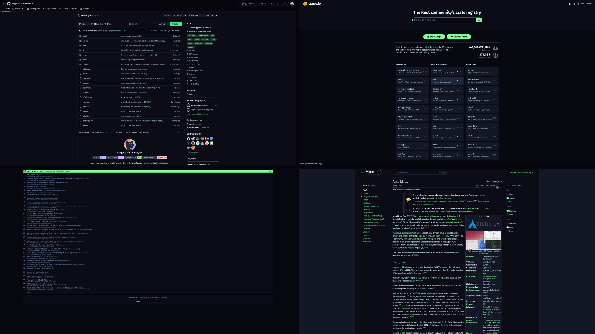
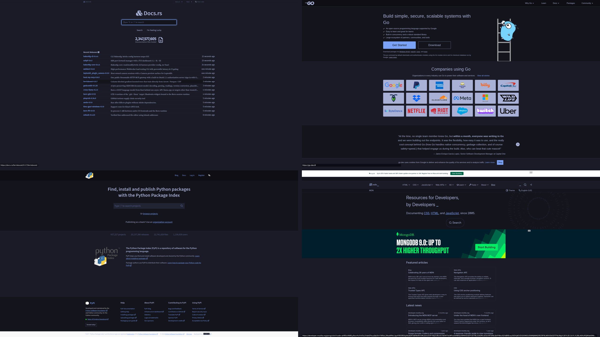
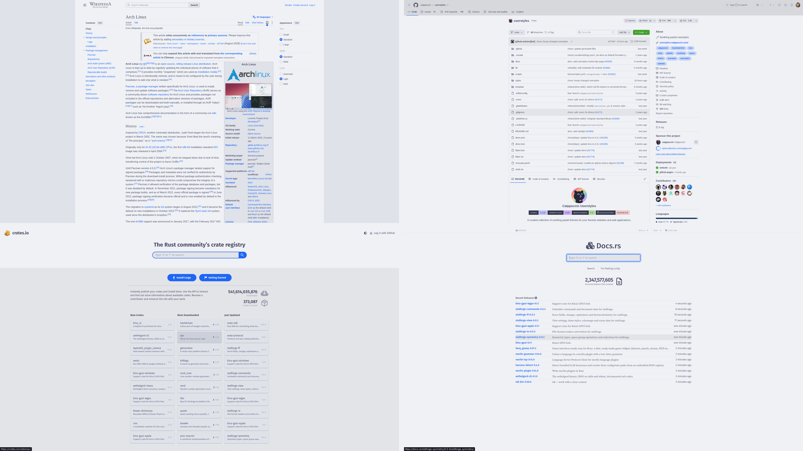

# OmaWeb

**Omarchy themes your browser. OmaWeb reshapes the official Catppuccin
userstyles bundle to the active theme and hands it to the normal Stylus
extension — no forked styles, no custom engine, no local server.**



Stock Catppuccin userstyles are beautiful, but they are *Catppuccin*: a fixed
palette chosen by hand and frozen there. Your desktop is
Hackerman neon, Tokyo Night blue or Catppuccin Latte cream; your browser is
still pastel. OmaWeb closes that gap.

It compiles the official [Catppuccin userstyles](https://github.com/catppuccin/userstyles)
bundle against your active Omarchy `colors.toml` and writes the CSS into a tiny
**asset extension** of its own: a manifest plus CSS files, with no permissions
and no scripts. The signed [Stylus](https://github.com/openstyles/stylus) from
the Chrome Web Store stays the userstyle manager. Stylus keeps doing what it is
good at (matching URLs, per-site toggles); OmaWeb only supplies colour.

Sites that no Catppuccin style covers stay exactly as the site ships them.
For those pages there is an optional Dark Reader export: OmaWeb generates a
settings file from the active theme, but Dark Reader itself is a separate
store install because its settings import cannot be automated. That is the same
manual step as importing the Stylus shims; both are documented below.

## What you get

- **The whole Catppuccin userstyle set**, reshaped to *your* palette — 135
  styles covering GitHub, Wikipedia, Hacker News, YouTube, Reddit, ChatGPT,
  Gmail, docs.rs, crates.io, MDN, Go, PyPI, search engines and more.
- **Theme switches without re-importing.** The shim URL never changes; OmaWeb
  rewrites the extension files and Chromium re-reads them on the next page
  load. No Stylus re-import, no browser restart.
- **Live per-style toggles.** `omaweb disable <id>` writes an empty file; the
  change applies on the next page load. Every style is on by default,
  including the login-walled ones.
- **Theme mixing, like the other Oma plugins.** Pin the browser to any
  installed theme while the desktop stays where it is: `omaweb theme use
  tokyo-night` — the same move as `omahud set`, `omacursor set` or `omavt set`.
- **An optional Dark Reader bridge.** One JSON import colours every site
  Catppuccin does not cover, in the same palette — and OmaWeb knows which sites
  to leave to Stylus.
- **A portable state bundle.** Config only, no credentials.





## How it works

```
Omarchy theme switch
        │
        ▼
omaweb apply ── lessc + theme palette ──► ~/.local/share/omaweb/extension/
        │                                       │
        │                                       │  chrome-extension://…/s/github/0.css
        │                                       ▼
        │                              Stylus shim styles (imported once)
        │
        └── darkreader export ──► ~/Downloads/omaweb-darkreader.json
                                       │
                                       ▼
                              Dark Reader → Import Settings
```

The shim styles are tiny `@import` wrappers. Chromium loads the imported CSS
from the asset extension, so no local server, loopback permission, certificate
or browser-wide network flag is involved. It works on HTTPS pages and under
strict CSP because Stylus injects the stylesheet as an extension, not as page
markup.

Two consequences worth knowing:

- **Theme switches need no re-import.** `omaweb apply` rewrites the files in
  the extension; Chromium re-reads them on the next page load.
- **Enable/disable is live.** Every shim is enabled in Stylus, but a disabled
  style is written as an empty CSS file.

No remote debugging, no profile patching, no custom styling engine. OmaWeb does
not paint sites that no style covers; Dark Reader is the optional separate
install for that.

## Requirements

- Omarchy (any theme with `colors.toml`)
- Python 3.9+
- `lessc` (`npm install --prefix ~/.local/share/omaweb/less less@4` — the
  installer does this)
- Chromium, Chrome, Brave, Brave Origin, Edge or Vivaldi
- [Stylus](https://chromewebstore.google.com/detail/stylus/clngdbkpkpeebahjckkjfobafhncgmne)
  from the Chrome Web Store (the manager; OmaWeb never modifies it)
- optionally, [Dark Reader](https://chromewebstore.google.com/detail/dark-reader/eimadpbcbfnmbkopoojfekhnkhdbieeh)
  for sites that no style covers — a separate store install, not part of
  `install.sh` (see below)

OmaWeb supports the Chromium family only. Firefox, Zen and LibreWolf refuse
unsigned extensions, so the automatic half of the design cannot exist there,
and Omarchy does not theme their outer shell either. The installer detects them
and explains that instead of pretending to support them.

OmaWeb creates one small extension of its own at
`~/.local/share/omaweb/extension`: a manifest plus generated CSS, with **no
permissions, no content scripts and no JavaScript**. Its id is pinned by a
public `key`, so the shim URLs are stable across machines.

> **Chromium will call the asset extension "Unpacked".** That is expected: its
> CSS is rewritten on every theme switch. The store copy of Stylus stays a
> normal, auto-updating install.

## Marketplace consent (theme-set hook)

Installing the plugin only drops the code. The theme-set hook edits your
Omarchy config, so it stays **opt-in**.

From the Omarchy marketplace, install OmaWeb and answer the installer's prompt
in the same terminal. Or run it yourself:

```bash
# from the plugin directory
./install.sh
```

Interactive `./install.sh` asks before arming the hook. `--yes` means "I
consent — arm everything this plugin supports, skip Y/n":

```bash
~/.config/omarchy/plugins/io.github.alxwolfenstein97.omaweb/install.sh --yes
```

The installer:

1. installs `lessc` under `~/.local/share/omaweb/less` if needed,
2. detects the Chromium-family browsers you run and adds the OmaWeb asset
   extension to the existing `--load-extension=` line in each browser's flags
   file (`chromium-flags.conf`, `brave-flags.conf`, `vivaldi-stable.conf`, …),
   preserving every other entry. This is line surgery, not a managed block:
   OmaWeb keeps all other lines as they are and only adds or removes its own
   path. A stock Omarchy flags file already lists `copy-url`, `yt-dlp` and
   `whatsapp-slim`; those stay, and Omarchy's later migrations can still append
   to the same line. `unwire` deletes a file only when our path was the only
   meaningful content left.
3. arms the `theme-set.d` hook so every `omarchy theme set` recompiles the CSS
   (or pass `--with-theme-hook` / `--yes`; `--no-theme-hook` removes it),
4. compiles the bundle and writes the CSS into the asset extension,
5. links `omaweb` into `~/.local/bin`.

If the default browser is Firefox-family and no Chromium-family browser is
installed, the installer prints the reason and stops. If both are present, it
wires the Chromium-family one and says plainly that the default browser stays
unthemed.

Then install **Stylus** once from the Chrome Web Store and import the shims:

```bash
omaweb stylus import --open
```

Pick `~/Downloads/omaweb-stylus.json` in **Manage → Import** (the picker hides
`~/.local`, so a visible copy is written there). You can also drag the file
onto the Stylus manager. You should see styles named `OmaWeb · …`, one per Catppuccin style.

`omaweb stylus status` prints `import: not yet` until the shims are in Stylus,
and `import: done` afterwards, so you do not have to guess whether the import
took.

> **Do not** enable Stylus's "use adopted stylesheets" option. Adopted
> stylesheets cannot contain `@import`.

The flag step is optional. `./install.sh --no-wire` leaves the browser flags
files alone; load `~/.local/share/omaweb/extension` once via `chrome://extensions`
→ **Developer mode** → **Load unpacked** instead. The choice is remembered
(`~/.local/state/omarchy/omaweb/no-wire`), so the per-shell service does not
quietly re-add the flag; `./install.sh --wire` or `omaweb browser wire`
switches back. Because the manifest pins a `key`, the extension id is identical
either way, so the shims keep working.

On a new box the CSS does not come from git. The repository holds the compiler
and the adapters; `omaweb apply` (which the installer runs) downloads the
Catppuccin `import.json` bundle into `~/.cache/omarchy/omaweb/bundle/`, compiles
it with `lessc` for the active theme, and writes the result to
`~/.local/share/omaweb/`. The asset extension and the Stylus export are then
generated from that build. A cached bundle is reused offline.

Newer Catppuccin bundles are **not** fetched automatically. `omaweb apply`
only downloads when the cache is missing, so theme switches stay offline. To
check and refresh by hand:

```bash
omaweb scan                  # what changed upstream since the cached bundle
omaweb fetch && omaweb apply # download the newer bundle and rebuild
```

`omaweb fetch` uses a conditional request (`If-None-Match` /
`If-Modified-Since`), so it is cheap when the bundle has not changed and it
reports `unchanged` instead of downloading 2.7 MB again. Nothing generated ever
enters the repository, so theme and bundle changes create no commits.

An update does **not** normally need a Stylus re-import. The shim URLs are
stable (`chrome-extension://…/s/<style>/<block>.css`) and `omaweb apply`
rewrites the CSS behind them, so new colours, upstream fixes and your
enable/disable choices land on the next page load. Re-import only when the
*set* of styles changes — upstream adds a style, or a style gains or loses a
block section. Run `omaweb stylus import` first (it refreshes the visible
`~/Downloads/omaweb-stylus.json`) and import that copy, not an older one.

Your `take`, `restore` and `unthemed` choices live in
`~/.config/omaweb/config.json`, never in the Stylus export, so re-importing
cannot undo them. Dark Reader is separate: when an update adds or removes
styles, run `omaweb darkreader export` and import the new settings so its
`disabledFor` list matches.

Re-importing is a reconcile, not a duplicate merge: Stylus matches styles by
name and updates them in place, so running it twice is harmless. There is no
safe automated way to wipe only the OmaWeb shims — Stylus has no external API,
and OmaWeb will not write its IndexedDB behind its back — but you do not need
one. Stale shims for a style removed upstream are inert because their CSS file
is gone. Ignore the import report's orphan list ("installed styles not in the
backup"): it contains your own Stylus styles, and its Delete button would
remove them too.

## Dark Reader (separate, optional)

OmaWeb styles the sites it knows. Dark Reader is the fallback for everything
else: a full JS theming engine that handles shadow DOM and background images
better than a page repaint. It is **not** installed by `install.sh` and is not
part of the automatic theme hook, because Dark Reader keeps its settings in
private extension storage and has no external control API. Its settings import
is a manual step, exactly like the first Stylus import.

### Install Dark Reader

Both extensions come from the Chrome Web Store: Stylus is the manager, Dark
Reader is the fallback. The store is the consistent, up-to-date path. The Arch
`stylus` package is the CSS preprocessor, not the browser extension, and
`extra/dark-reader` trails the store release.

Install
[Dark Reader](https://chromewebstore.google.com/detail/dark-reader/eimadpbcbfnmbkopoojfekhnkhdbieeh)
normally. OmaWeb does not install or load it, and it does not add it to the
browser flags.

### Generate and import the theme

```bash
omaweb darkreader export
```

This writes `~/.local/share/omaweb/darkreader.json` and a visible copy at
`~/Downloads/omaweb-darkreader.json`. In Dark Reader, open
**Settings → Advanced → Import Settings** and pick the visible copy. The import
applies immediately; no browser restart is needed. It replaces Dark Reader's
theme and its enabled/disabled site lists, so exclusions you added inside Dark
Reader are replaced; OmaWeb's own `unthemed` opt-outs are merged into the file
and survive. The rest of Dark Reader's settings are kept. `--json` prints the
payload instead of writing files, and `--path FILE` writes an extra copy.
`omaweb status` shows whether an export exists.

The file contains:

- the active theme's `base` background, `text` colour, `surface2` selection and
  `surface1` scrollbar, with Dark Reader's dynamic-theme engine;
- `mode: 1` for a dark theme and `mode: 0` for a light one, so a Latte-style
  theme gets a light web instead of a dark one;
- `disabledFor`: every site that an enabled OmaWeb style already paints, plus
  every site in `darkreader.unthemed`. A disabled style is skipped too. Regexp
  matches stay regexps, and path prefixes keep their path, so Dark Reader is
  not switched off for a whole host when OmaWeb only themes one path;
- `detectDarkTheme: true`, so sites with their own dark mode are left alone.

### After a theme switch

Dark Reader cannot watch Omarchy's theme. The theme hook still runs `omaweb
apply` for the CSS; regenerate the Dark Reader file afterward:

```bash
omaweb darkreader export
```

Then import `~/Downloads/omaweb-darkreader.json` again. The import applies live
and replaces Dark Reader's theme and site lists. This is the same model as
Catppuccin's manual Dark Reader recipe, but the colours come from the live
`colors.toml` instead of being copied by hand.

### Letting Dark Reader take a site

Dark Reader is disabled on every site an enabled OmaWeb style paints. If a
covered site looks broken — or you simply prefer Dark Reader there — hand it
over:

```bash
omaweb darkreader take wiki.archlinux.org
```

That disables the OmaWeb style(s) that paint the site, clears any `unthemed`
opt-out for it, and regenerates the settings file. Import
`~/Downloads/omaweb-darkreader.json` in Dark Reader. The command prints the
style ids it disabled.

To hand the site back to Catppuccin, use the inverse:

```bash
omaweb darkreader restore wiki.archlinux.org
```

That re-enables every OmaWeb style that covers the site, removes any `unthemed`
opt-out, rebuilds, and regenerates the settings file, so import it once more.
`omaweb enable arch-wiki` (or whichever id) works too, but `restore` takes the
site rather than the id and keeps Dark Reader in sync.

If a style paints several sites, `take` prints a note, because handing one site
to Dark Reader also disables that style everywhere else. `omaweb match <url>
--all` lists the styles that cover a page including disabled ones, marked
`(disabled)`, which is the quickest way to find what `take` turned off.

### Leaving a site unthemed

If Dark Reader's result is worse than the raw page, keep both engines off:

```bash
omaweb darkreader unthemed moddb.com
```

This disables any OmaWeb style that covers the site and adds it to the generated
`disabledFor` list, so Catppuccin and Dark Reader both stay out. The opt-out
lives in `~/.config/omaweb/config.json` under `darkreader.unthemed` and is
merged into every export, so a Dark Reader settings import does not wipe it.

`omaweb darkreader list` shows the opt-outs. `omaweb darkreader unthemed <site>
--remove` lets Dark Reader theme the site again, and `omaweb darkreader restore
<site>` hands it back to Catppuccin. `omaweb status` also shows the opt-outs.

> `archlinux.org` has no OmaWeb style; `arch-wiki` covers only
> `wiki.archlinux.org`. If the main Arch site looks themed, that is Dark
> Reader's dynamic theme, not Catppuccin.

### Resetting exclusions

If you lose track of what you turned off, clear every per-site choice at once:

```bash
omaweb reset --dry-run   # show what would be cleared
omaweb reset             # ask first, then rebuild
```

That removes every style override and every `darkreader.unthemed` opt-out, so
all styles are on again, and regenerates the Dark Reader settings. A pinned
theme is kept. `--yes` skips the prompt, and `--path FILE` writes the settings
somewhere other than `~/Downloads`.

## Commands

```
omaweb apply [--force] [--no-fetch] [--quiet] [--jobs N] [--timeout S]
omaweb fetch [--force] [--json] [--quiet]
omaweb scan [--offline] [--json] [--quiet]
omaweb status [--json]
omaweb doctor [--json]
omaweb list [--enabled|--disabled] [--json]
omaweb enable  <style-id>... | --all
omaweb disable <style-id>... | --all
omaweb reset   [--dry-run] [--yes] [--json] [--path FILE]
omaweb match   <url> [--all]
omaweb state   export [FILE] | import FILE [--replace]
omaweb stylus  status|import [--open]|open|install
omaweb darkreader export [--json] [--path FILE]
omaweb darkreader take <site> [--json] [--path FILE]
omaweb darkreader restore <site> [--json] [--path FILE]
omaweb darkreader unthemed <site> [--remove] [--json] [--path FILE]
omaweb darkreader list [--json]
omaweb browser detect|status|wire|unwire
omaweb theme   show|list|use <name>|auto
```

`omaweb` with no arguments prints the current state. `omaweb match <url>` shows
which enabled styles match a page, which is the quickest way to find the id to
disable or hand to Dark Reader. Add `--all` to include disabled styles, marked
`(disabled)`.

## Configuration

`~/.config/omaweb/config.json` (created on first run):

```json
{
  "version": 1,
  "theme": "auto",
  "overrides": {
    "twitter": false
  },
  "darkreader": {
    "unthemed": []
  }
}
```

- `theme` — `auto` follows the desktop theme. An installed Omarchy theme name
  (for example `tokyo-night`) paints the browser in that theme instead, while the
  desktop stays where it is. See [Mixing themes](#mixing-themes).
- `overrides` — explicit per-style on/off. Missing keys are on, including the
  login-walled styles. `omaweb disable <id>` opts one out; `omaweb disable
  --all` opts the whole set out, and `omaweb enable --all` turns it back on.
  Both are live and write overrides.
- `darkreader.unthemed` — sites where Dark Reader must stay off because the raw
  page is better than its approximation (`["moddb.com"]`). `omaweb darkreader
  unthemed <site>` manages this; the list is merged into every generated
  `disabledFor`, so importing Dark Reader settings does not wipe it.

Styles that need an account (Gmail, ChatGPT, Instagram, LinkedIn, …) are
enabled like everything else, so a fresh box exercises the whole set. Use
`omaweb disable <id>` if a half-painted login page bothers you in normal use.

## Mixing themes

OmaWeb can render in a different installed theme than the desktop. This is the
same idea as the other Oma appearance plugins: `omahud set tokyo-night` pins the
HUD palette, `omacursor set tokyo-night` repaints the pointer, `omavt set
tokyo-night` rewrites the TTY drop-in — each paints one surface from a chosen
palette without flipping the whole machine.

```bash
omaweb theme list              # installed Omarchy themes
omaweb theme use tokyo-night    # pin OmaWeb to Tokyo Night
omaweb theme show              # what OmaWeb is rendering, and why
omaweb theme auto              # follow the desktop again
```

The pin lives in `config.json` as `"theme": "tokyo-night"`. A theme switch still
runs the hook, but `omaweb apply` keeps the pinned palette until you clear it.
`omaweb theme show` names both the pinned theme and the desktop theme, so the
state is never ambiguous.

## Bundle changes

`omaweb scan` answers one question: has Catppuccin changed anything since the
bundle OmaWeb compiled? It downloads the current `import.json` next to the
cached copy, compares style versions and source digests, and lists what is
updated, added, removed or changed in place. Styles enabled here are marked, so
you can see whether a change affects your setup before refreshing.

```bash
omaweb scan
omaweb scan --offline          # compare against the last downloaded copy
```

It writes `scan.json` and `scan.md` to `~/.local/state/omarchy/omaweb/`. The
upstream copy and its ETag live in `~/.cache/omarchy/omaweb/scan/`, so the next
scan is a conditional request rather than a full download.

The scan is advisory. OmaWeb never disables or patches a style on its own; you
decide what to turn off with `omaweb disable`, and `omaweb fetch && omaweb
apply` picks up the newer bundle.

## Portable state

`omaweb state export` writes one JSON bundle with the config: theme pin,
per-style overrides and Dark Reader opt-outs. `omaweb state import` merges it
into another box:

```bash
omaweb state export                  # ~/omaweb-state.json
omaweb state import ~/omaweb-state.json
omaweb state import ~/omaweb-state.json --replace
```

Merging keeps existing overrides, adds the incoming ones, and unions the
`unthemed` lists. `--replace` replaces the config instead. The bundle contains
no credentials, but it does name the sites you care about, so treat it like a
dotfile.

The bundle itself is still downloaded and compiled on each box; the state file
only carries the choices. Scan data is not portable: it is a cache of what
upstream looked like at one moment, so a fresh box runs `omaweb scan` instead.

## Limits, honestly

- **Firefox, Zen and LibreWolf are out of scope.** They refuse unsigned
  extensions, so OmaWeb cannot load its helper or its Stylus shims there, and
  Omarchy does not theme their outer shell either. OmaWeb extends Omarchy's
  theming; it does not reimplement it for a browser that blocks the mechanism.
- **OmaWeb is CSS only.** A site that needs scripted theming, shadow DOM
  surgery or a background-image rewrite is not worth a fragile local style.
  Leave it to Dark Reader or the site's own dark mode.
- **A theme switch does not update Dark Reader.** Regenerate and re-import the
  settings file after a switch. There is no external API to push it.
- **The asset extension is "Unpacked".** Chromium will warn about developer
  mode. Its CSS is rewritten on every theme switch, so that is expected; the
  store copy of Stylus stays a normal install.
- **Login walls are enabled like everything else.** A public login page can
  look half-painted; disable that style or hand it to Dark Reader.
- **Catppuccin styles are upstream.** When a site breaks its own style, the fix
  comes from the Catppuccin bundle. `omaweb fetch` picks up a newer bundle;
  OmaWeb does not patch individual styles.
- **Some Catppuccin styles compile to nothing useful.** One style currently
  produces no supported `@-moz-document` selectors; `omaweb status` counts it
  as a compile error and the rest of the set is unaffected.

## Troubleshooting

Start with:

```bash
omaweb doctor
```

It checks Python, `lessc`, the theme, the cached bundle, the build, the asset
extension, Stylus, the import state, the browser wiring and the config.

| Symptom | Fix |
| --- | --- |
| Pages are unstyled | `omaweb stylus status`; if `import: not yet`, run `omaweb stylus import --open` |
| Theme changed, pages did not | `omaweb apply`, then reload the page |
| Chrome says the extension is unpacked | Expected; the asset extension is regenerated on every theme switch |
| `omaweb` not found | Re-run `./install.sh`, or add `~/.local/bin` to `PATH` |
| Extension not loaded | `omaweb browser wire` and restart the browser, or load `~/.local/share/omaweb/extension` by hand |
| Default browser is Firefox/Zen/LibreWolf | Not supported — OmaWeb needs a Chromium-family browser (see [Limits](#limits-honestly)) |
| Dark Reader ignores the import | Re-run `omaweb darkreader export` and import the visible copy in `~/Downloads` |
| A covered site looks broken | `omaweb darkreader take <site>` |
| Catppuccin should come back on a site | `omaweb darkreader restore <site>` |
| You lost track of takes and opt-outs | `omaweb reset --dry-run`, then `omaweb reset` |
| A raw page is better than either engine | `omaweb darkreader unthemed <site>` |
| A style is broken upstream | `omaweb disable <id>` until the next `omaweb fetch` |

`omaweb status` is the one-screen summary: theme, build hash, enabled count,
extension id, Stylus import state and Dark Reader export.

## Security

- **No server, no port, no certificate.** The CSS is read through
  `chrome-extension://`, so nothing listens on loopback.
- **No permissions and no scripts.** The asset extension's manifest exposes
  `s/*` and `theme.json` and declares nothing else.
- **The bundle is data, not code.** `lessc` is told to refuse `@plugin` where
  the compiler supports it, and OmaWeb itself rejects `@plugin`, inline
  JavaScript and any import that is not CSS or its vendored palette library.
  A replaced Catppuccin export can change CSS; it cannot run Node code.
- **No patched extension.** Stylus and Dark Reader are the signed store builds;
  OmaWeb never vendors or modifies them.
- **No browser-wide flags beyond `--load-extension`.** The installer edits only
  that one flag line and preserves every other entry. `--no-wire` skips it
  entirely.
- **No credentials.** The portable state contains config only.

## Disable vs remove

| Action | What happens |
| --- | --- |
| `omarchy plugin disable …` | Shell service stops. **Theme hook still runs** — the CSS stays current on every theme switch. |
| `./uninstall.sh` | Hook removed, asset extension unwired, generated data stripped, CLI link removed. Config kept. |
| `./uninstall.sh --yes` | Same teardown, plus removes `~/.config/omaweb` and asks Omarchy to remove the plugin. |

`uninstall.sh` does **not** uninstall Stylus or Dark Reader, and it does not
remove your Stylus styles. Remove the `OmaWeb · …` styles in Stylus yourself if
you want them gone; everything else is regenerated on the next install.

## Check

```bash
bash ~/.config/omarchy/plugins/io.github.alxwolfenstein97.omaweb/check.sh
```

The check is hermetic: it builds into a temporary config, exercises the
compile/publish path, the Stylus export, the Dark Reader export, enable/disable,
browser detection and flag wiring (including Brave Origin and Vivaldi), the
bundle diff, the theme override, and the config-only state bundle, then cleans
up.

## Credits

- [Catppuccin userstyles](https://github.com/catppuccin/userstyles) — the
  styles themselves. OmaWeb only recolours them.
- [Stylus](https://github.com/openstyles/stylus) — the userstyle manager that
  does the actual injection.
- [Dark Reader](https://github.com/darkreader/darkreader) — the optional engine
  for everything Catppuccin does not cover.
- Sibling extenders: [Chroma](https://github.com/AlxWolfenstein97/chroma),
  [OmaOBS](https://github.com/AlxWolfenstein97/omaobs),
  [OmaCursor](https://github.com/AlxWolfenstein97/omacursor),
  [OmaBoot](https://github.com/AlxWolfenstein97/omaboot),
  [OmaVT](https://github.com/AlxWolfenstein97/omavt),
  [OmaTTY](https://github.com/AlxWolfenstein97/omatty),
  [OmaHud](https://github.com/AlxWolfenstein97/omahud),
  [OmaMenu](https://github.com/AlxWolfenstein97/omamenu).
- Theme previews: Hackerman, Catppuccin Latte and Tokyo Night, all from the
  Omarchy theme set.
- [Omarchy](https://omarchy.org/) — the theme pipeline and `theme-set` hooks
  OmaWeb stays aligned with.

## License

MIT — see [LICENSE](LICENSE).
